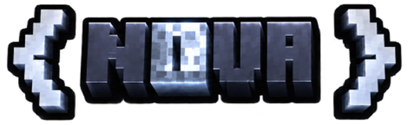
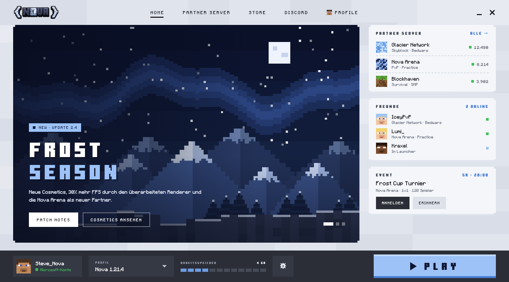
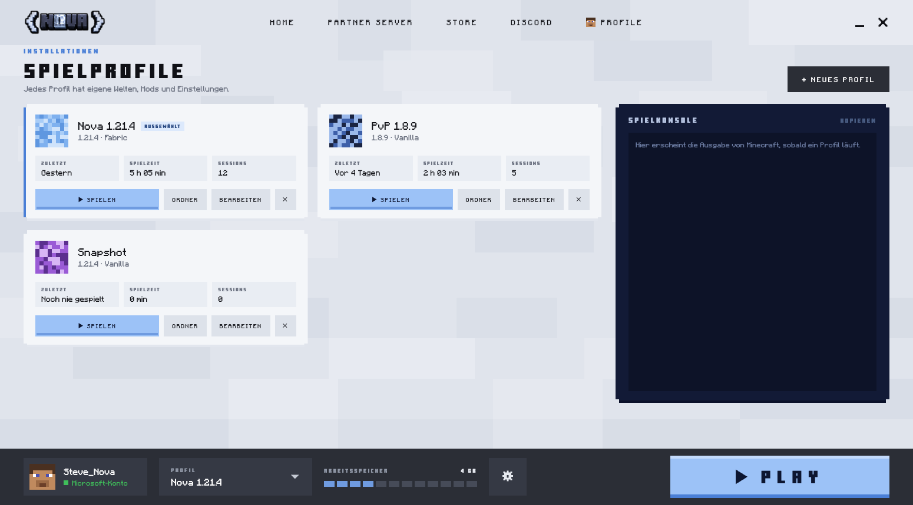
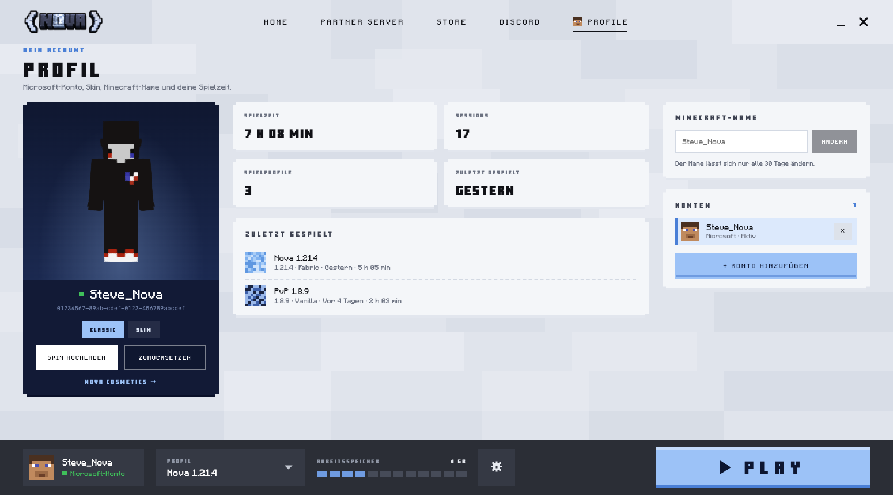
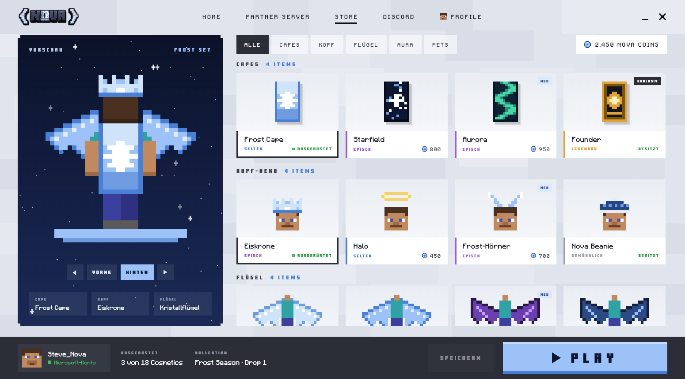
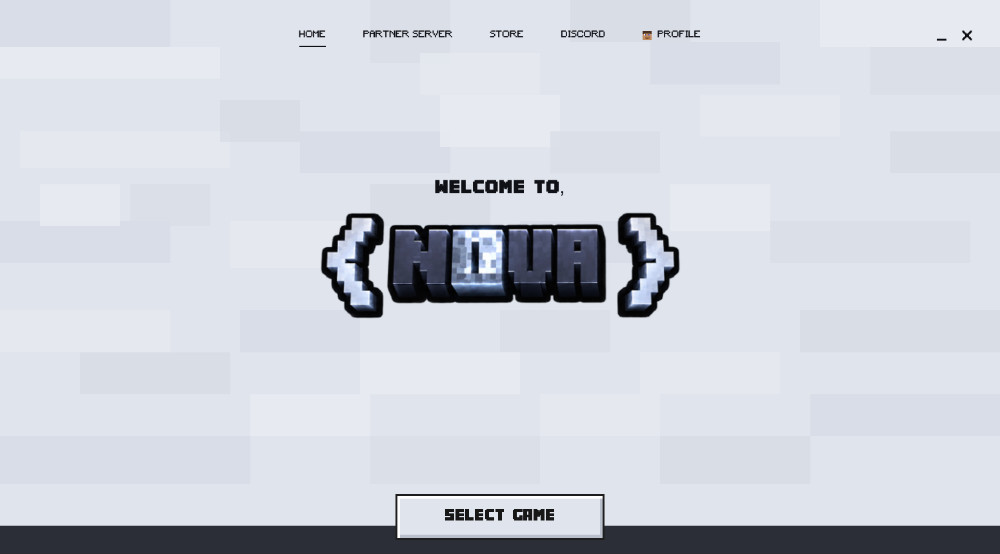

  

  <strong>A pixel-styled desktop launcher for Minecraft: Java Edition.</strong> 
  Sign in with your Microsoft account, manage game profiles and play – in one window.

  

> **Status:** in active development. The source code is not public at this time.
> Screenshots show the current interface; some sections (news, partner servers, friends, store)
> still use placeholder content.

## Features

**Microsoft account sign-in**
- Sign in with the Microsoft account that owns Minecraft: Java Edition
- Uses the OAuth 2.0 device code flow: you enter a short code on microsoft.com – the launcher never sees your password
- Multiple accounts with quick switching; sessions are refreshed automatically

**Minecraft profile**
- 3D preview of your skin
- Upload a new skin (classic or slim) or reset it
- Change your Minecraft name (with availability check)

**Game profiles**
- Separate profiles with their own worlds, mods and settings
- Any Minecraft release or snapshot, Vanilla or [Fabric](https://fabricmc.net)
- Play time and session statistics per profile
- One click opens the profile's mods folder

**Launching**
- Downloads the game, libraries, assets and the matching Java runtime automatically from official Mojang servers (Fabric from Fabric's servers) and verifies them with checksums
- Memory, resolution, fullscreen and JVM arguments are configurable
- Built-in game console, start/stop from the launcher
- Join a server directly from the launcher

**Coming next:** Nova cosmetics, news feed, partner servers and friends.

## Screenshots

| Game profiles | Account & skin |
| --- | --- |
|  |  |

| Cosmetics wardrobe (preview) | First start |
| --- | --- |
|  |  |

## Privacy & security

Nova Launcher talks only to the services it needs:

| Service | Purpose |
| --- | --- |
| Microsoft identity platform (`login.microsoftonline.com`) | Sign-in (scopes `XboxLive.signin offline_access`) |
| Xbox Live (`user.auth.xboxlive.com`, `xsts.auth.xboxlive.com`) | Exchange the Microsoft token for an Xbox token |
| Minecraft services (`api.minecraftservices.com`) | Verify game ownership, load the player profile, skin and name changes requested by the player |
| Mojang download servers | Game files, assets and Java runtime |
| Fabric (`meta.fabricmc.net`, `maven.fabricmc.net`) | Fabric loader for profiles that use it |

- Tokens are stored **only on your device**, in a file readable only by your user account.
- No account data is sent to Nova servers or any third party, and there is no tracking or analytics.
- Signing out removes the stored tokens for that account.

## Platform

Built with [Tauri 2](https://tauri.app) (Rust) and React. Developed and tested on macOS;
Windows and Linux support is planned.

## Contact

Questions or feedback? Please [open an issue](../../issues).

---

NOT AN OFFICIAL MINECRAFT PRODUCT. NOT APPROVED BY OR ASSOCIATED WITH MOJANG OR MICROSOFT.
Minecraft is a trademark of Mojang AB.
